# Туршилт, Үр дүн

## 1. Зорилго ба хамрах хүрээ

Sleeping Teaching Assistant симуляцийн (`src/ta_core.py`, `src/ui.py`) зөв ажиллагааг гурван түвшинд шалгав:

1. **Автомат тест (core):** багийн бичсэн 11 тест (`src/test_ta_core.py`).
2. **Edge case тест:** хязгаарын утга, ер бусын дараалал, synchronization-ы зөв байдлыг шалгах 27 нэмэлт тест (`tests/test_edge_cases.py`).
3. **UI сценари:** 11 сценарийг UI дээр ажиллуулж, screenshot авч, дэлгэц дээрх тоог хүлээгдэх үр дүнтэй тулгав (`tests/ui_scenarios.py`).

## 2. Туршилтын орчин

| Зүйл | Утга |
|---|---|
| Үйлдлийн систем | macOS 26.6.2 |
| Python | 3.14.10 (Tk 9.0) |
| Төслийн хувилбар | main, commit 198e554 |
| Core | src/ta_core.py (thread, Semaphore, Lock) |
| UI | src/ui.py (Tkinter dashboard), Visual speed 1.00× |
| Огноо | 2026.10.28 |

## 3. Туршилтын арга

Сценариудыг бодлогын нөхцөлөөс гурван төрөлд хуваан тодорхойлсон: **хэвийн** (үндсэн урсгал), **хязгаар** (хамгийн бага ба хамгийн их утга), **алдаа** (буруу оролт), мөн **удирдлага** (START, PAUSE, STEP, RESET). Сценари бүрийн хүлээгдэх үр дүнг ажиллуулахаас өмнө бичсэн. Симуляци санамсаргүй (UI-д seed байхгүй) тул хүлээгдэх үр дүнг чанарын хэлбэрээр заасан.

UI сценариудыг `tests/ui_scenarios.py` скриптээр гүйцэтгэсэн: скрипт Dashboard цонхыг нээж, талбаруудад оролтыг бичиж, START, PAUSE, STEP, RESET үйлдлийг хугацаатай дуудаж, тогтоосон мөчид цонхны screenshot авч, дэлгэц дээр харагдаж буй тоолуурыг (үйлчлүүлсэн, буцсан, дараалал, TA-ийн төлөв) JSON-д хадгалсан. UI-ийн тоог бодит core-ийн тоотой харьцуулахын тулд мөн ижил тохиргоог UI-гүйгээр ажиллуулсан (`tests/core_scenarios.py`).

## 4. Сценарийн тодорхойлолт

Оролт: сандал / оюутан / ирэх хугацаа (сек) / үйлчилгээний хугацаа (сек).

| ID | Нэр | Төрөл | Зорилго | Оролт | Алхам | Хүлээгдэх үр дүн |
|---|---|---|---|---|---|---|
| S1 | Үндсэн ажиллагаа | Хэвийн | Бодлогын үндсэн урсгалыг шалгах | 3 / 5 / 1.0 / 1.5 | START, 20 сек хүлээх | TA эхэнд унтсан. Оюутан ирэхэд сэрнэ, дарааллаар үйлчилнэ |
| S2 | Сандал дүүрэн | Хязгаар | Сандал дутуу үед оюутан буцдаг эсэх | 1 / 10 / 0.3 / 1.5 | START, 20 сек хүлээх | Оюутнууд буцаж, буцсан тоо нэмэгдэнэ. Дараалал сандлын тооноос хэтрэхгүй |
| S3 | Сандал хангалттай | Хэвийн | Хүн буцахгүй байх нөхцөл | 10 / 3 / 1.5 / 0.5 | START, 20 сек хүлээх | Хэн ч буцахгүй, буцсан тоо 0 |
| S4 | 0 сандал | Хязгаар | Сандалгүй үед системийн ажиллагаа | 0 / 5 / 0.5 / 1.0 | START, 15 сек хүлээх | Хэн ч үйлчлүүлэхгүй, TA унтсан хэвээр |
| S5 | Нэг оюутан | Хязгаар | TA ээлжлэн сэрж, унтдаг эсэх | 1 / 1 / 2.0 / 0.5 | START, 20 сек хүлээх | Оюутан бүрт TA сэрж, үйлчилсний дараа дахин унтана |
| S6 | Дээд ачаалал | Хязгаар | Хамгийн их сандал, оюутан үед гацахгүй эсэх | 20 / 50 / 0.2 / 0.5 | START, 20 сек хүлээх | Гацахгүй. Дараалал 20-оос хэтрэхгүй |
| S7 | PAUSE / RESUME | Удирдлага | Түр зогсоох товчийг шалгах | 3 / 5 / 1.0 / 1.5 | START, 5 сек, PAUSE, 4 сек хүлээх, START | PAUSE үед хөдөлгөөн зогсоно. START дарахад үргэлжилнэ |
| S8 | STEP | Удирдлага | Нэг алхмаар явуулах товчийг шалгах | 3 / 5 / 1.0 / 1.5 | START, PAUSE, STEP ×5 | STEP нэг дарахад нэг үйл явдал гарна |
| S9 | RESET | Удирдлага | Дахин эхлүүлэхэд төлөв цэвэрлэгддэг эсэх | 3 / 5 / 1.0 / 1.5 | START, 10 сек, RESET | READY төлөв. Бүх тоолуур, event тоо 0 |
| S10 | Буруу оролт: хязгаараас хэтэрсэн | Алдаа | Тохиргооны шалгалт | 25 / 5 / 1.0 / 1.5 | START | Алдааны мессеж гарна, симуляци эхлэхгүй |
| S11 | Буруу оролт: текст | Алдаа | Тохиргооны шалгалт | abc / 5 / 1.0 / 1.5 | START | Алдааны мессеж гарна, симуляци эхлэхгүй |

## 5. Сценарийн үр дүн

**Нийт 11 сценарийн 11 нь тэнцсэн.**

| ID | Нэр | Хүлээгдэх үр дүн | Бодит үр дүн | Үр дүн | Screenshot |
|---|---|---|---|---|---|
| S1 | Үндсэн ажиллагаа | TA эхэнд унтсан. Оюутан ирэхэд сэрнэ, дарааллаар үйлчилнэ | Эхлэхээс өмнө TA унтсан (S1_ready). 20 сек-ийн дараа: үйлчлүүлсэн 9, буцсан 12, дараалалд 3, TA HELPING. Core: TA 1 удаа сэрсэн | Тэнцсэн  | [S1](../tests/screenshots/S1.png), [S1_ready](../tests/screenshots/S1_ready.png) |
| S2 | Сандал дүүрэн | Оюутнууд буцаж, буцсан тоо нэмэгдэнэ. Дараалал сандлын тооноос хэтрэхгүй | Буцсан 78, дараалалд 1 (1 сандал дүүрэн), үйлчлүүлсэн 1 (UI) | Тэнцсэн ² | [S2](../tests/screenshots/S2.png) |
| S3 | Сандал хангалттай | Хэн ч буцахгүй, буцсан тоо 0 | Үйлчлүүлсэн 21, буцсан 0. Core: TA 10 удаа унтсан | Тэнцсэн  | [S3](../tests/screenshots/S3.png) |
| S4 | 0 сандал | Хэн ч үйлчлүүлэхгүй, TA унтсан хэвээр | Үйлчлүүлсэн 0, буцсан 64, TA SLEEPING, 0 / 0 seats | Тэнцсэн  | [S4](../tests/screenshots/S4.png) |
| S5 | Нэг оюутан | Оюутан бүрт TA сэрж, үйлчилсний дараа дахин унтана | 1 оюутан үйлчлүүлсний дараа TA дахин унтсан (S5_sleeping). 20 сек-ийн дараа үйлчлүүлсэн 6, буцсан 0. Core: TA 6 удаа сэрж, 6 удаа унтсан | Тэнцсэн  | [S5](../tests/screenshots/S5.png), [S5_sleeping](../tests/screenshots/S5_sleeping.png) |
| S6 | Дээд ачаалал | Гацахгүй. Дараалал 20-оос хэтрэхгүй | Гацаагүй (RUNNING). Дараалалд 20 / 20 (сандал дүүрэн, хэтрээгүй), буцсан 59, үйлчлүүлсэн 1 (UI). Core: 33 үйлчилсэн, дээд дараалал 20 | Тэнцсэн ² | [S6](../tests/screenshots/S6.png) |
| S7 | PAUSE / RESUME | PAUSE үед хөдөлгөөн зогсоно. START дарахад үргэлжилнэ | PAUSED үед event тоо 15 дээр 4 сек-ээс илүү өөрчлөгдөөгүй (15 → 15). START-ийн дараа 30 хүртэл үргэлжилсэн | Тэнцсэн  | [S7](../tests/screenshots/S7.png), [S7_pause](../tests/screenshots/S7_pause.png) |
| S8 | STEP | STEP нэг дарахад нэг үйл явдал гарна | Event тоо 6 → 7 → 8 → 9 → 10 → 10. STEP бүр хамгийн ихдээ 1 event нэмсэн. Сүүлийн дарахад event байгаагүй тул "WAITING FOR EVENT" гарсан | Тэнцсэн ³ | [S8](../tests/screenshots/S8.png) |
| S9 | RESET | READY төлөв. Бүх тоолуур, event тоо 0 | RESET-ийн өмнө: үйлчлүүлсэн 5, буцсан 5, event 27. RESET-ийн дараа: READY, үйлчлүүлсэн 0, буцсан 0, event 0 | Тэнцсэн  | [S9](../tests/screenshots/S9.png), [S9_before_reset](../tests/screenshots/S9_before_reset.png) |
| S10 | Буруу оролт: хязгаараас хэтэрсэн | Алдааны мессеж гарна, симуляци эхлэхгүй | INVALID INPUT төлөв. Мессеж: "Сандлын тоо 0-20 хооронд бүхэл тоо байна.". Симуляци эхлээгүй | Тэнцсэн ⁴ | [S10](../tests/screenshots/S10.png) |
| S11 | Буруу оролт: текст | Алдааны мессеж гарна, симуляци эхлэхгүй | INVALID INPUT төлөв. Мессеж: "'Сандлын тоо' нь бүхэл тоо байх ёстой (оруулсан: 'abc').". Симуляци эхлээгүй | Тэнцсэн ⁴ | [S11](../tests/screenshots/S11.png) |

² UI-ийн тоо core-оос хоцорч харагдана. Ижил тохиргоог core-оор шууд (UI-гүй) ажиллуулахад S2: үйлчлүүлсэн 11, S6: үйлчлүүлсэн 33 гарсан бол UI дээр 1 ба 1 харагдсан. Шалтгаан: UI нь event-үүдийг тогтмол хурдаар тоглуулдаг (Visual speed 1.00×) тул олон оюутан буцдаг үед event их үүсч, дүрслэл хоцорно. Core-ийн ажиллагаа зөв (дээд дараалал сандлын тоотой тэнцүү).

³ STEP нь буфер дотор event байвал яг нэгийг үзүүлнэ. Буфер хоосон бол core-г үргэлжлүүлж "WAITING FOR EVENT" гэж харуулна. Урьд нэг удаагийн ажиллуулалтад ийм үед хоёр event нэг дор орж ирсэн тохиолдол ажиглагдсан, иймд "нэг дарахад яг нэг" гэдэг нь дандаа биелдэггүй.

⁴ Алдааны цонхыг автоматаар барьж мессежийг нь уншсан. Цонх өөрөө screenshot-д ороогүй, харин INVALID INPUT төлөв харагдаж байна.

### 5.1 UI-ийн тоо ба core-ийн тоо

Ижил тохиргоог UI-гүйгээр core дээр шууд ажиллуулсан бодит тоо:

| ID | Оролт | Хугацаа (сек) | Үйлчлүүлсэн | Буцсан | Суусан | TA сэрсэн | TA унтсан | Дээд дараалал | UI: үйлчлүүлсэн | UI: буцсан |
|---|---|---|---|---|---|---|---|---|---|---|
| S1 | 3 / 5 / 1.0 / 1.5 | 20 | 11 | 11 | 15 | 1 | 0 | 3 | 9 | 12 |
| S2 | 1 / 10 / 0.3 / 1.5 | 20 | 11 | 434 | 13 | 1 | 0 | 1 | 1 | 78 |
| S3 | 10 / 3 / 1.5 / 0.5 | 20 | 20 | 0 | 22 | 11 | 10 | 2 | 21 | 0 |
| S4 | 0 / 5 / 0.5 / 1.0 | 15 | 0 | 120 | 0 | 0 | 0 | 0 | 0 | 64 |
| S5 | 1 / 1 / 2.0 / 0.5 | 20 | 6 | 0 | 6 | 6 | 6 | 1 | 6 | 0 |
| S6 | 20 / 50 / 0.2 / 0.5 | 20 | 33 | 2451 | 54 | 1 | 0 | 20 | 1 | 59 |

### 5.2 Screenshot-ууд

**S1** (Үндсэн ажиллагаа)

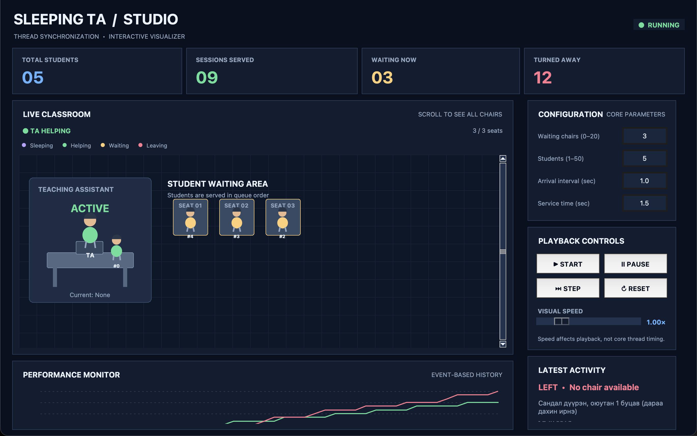

**S1_ready** (Үндсэн ажиллагаа)

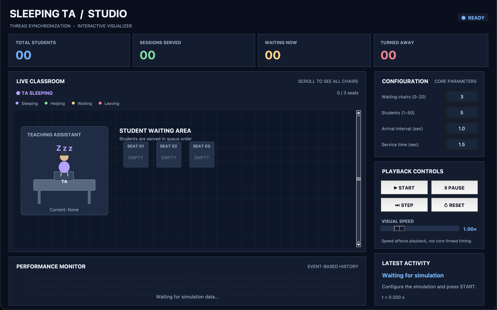

**S2** (Сандал дүүрэн)

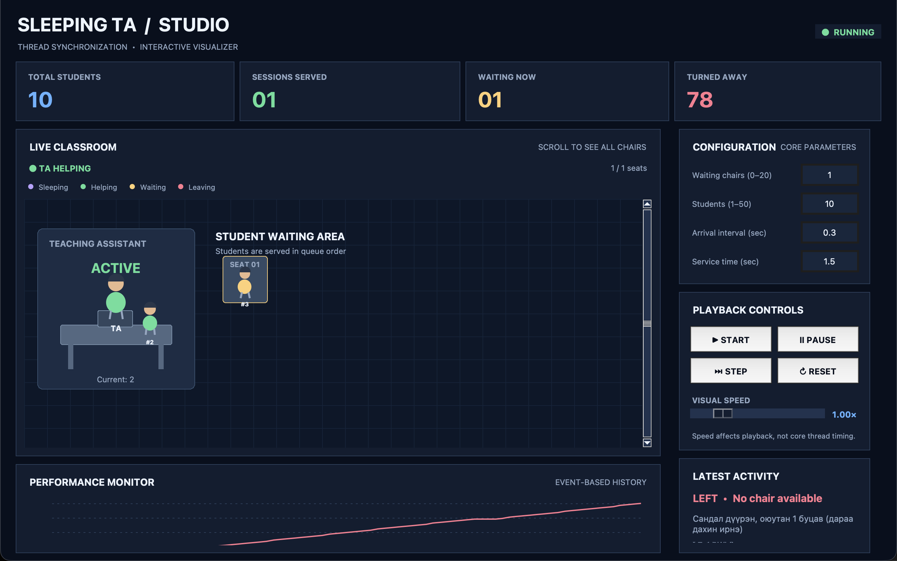

**S3** (Сандал хангалттай)

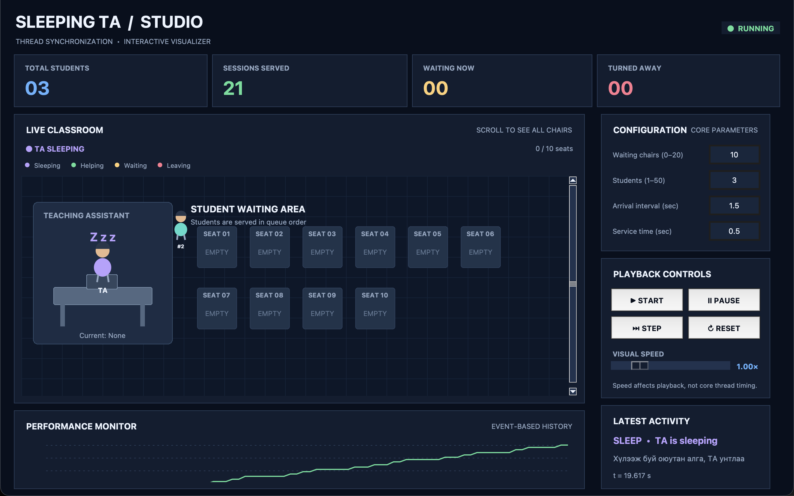

**S4** (0 сандал)

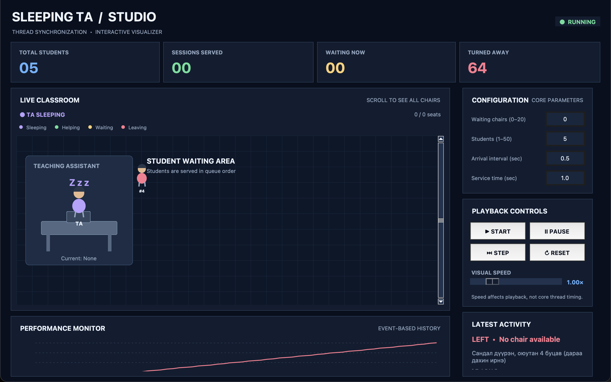

**S5** (Нэг оюутан)

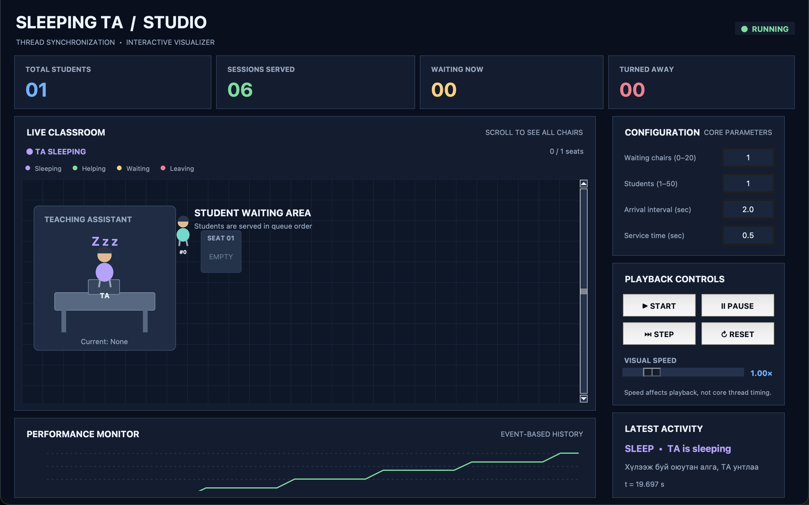

**S5_sleeping** (Нэг оюутан)

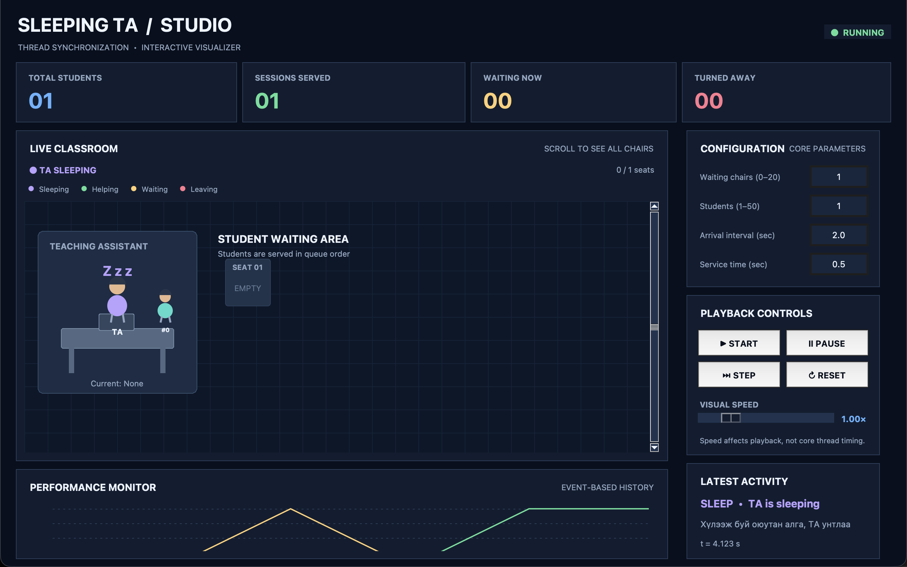

**S6** (Дээд ачаалал)

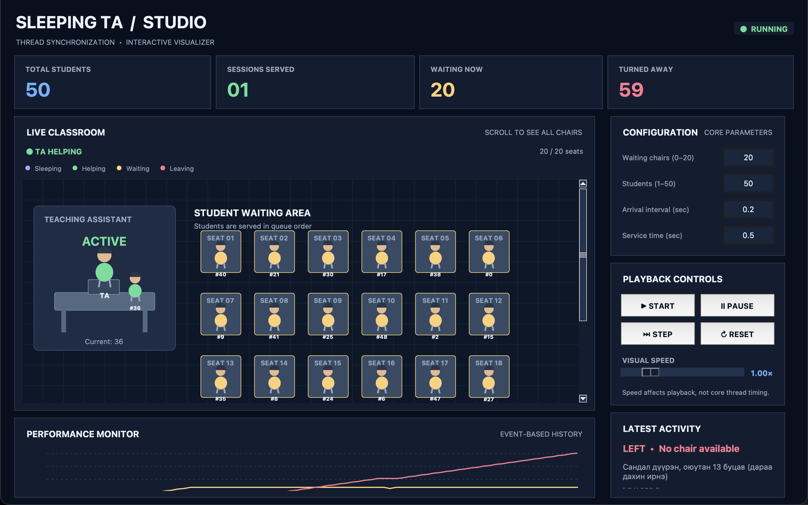

**S7** (PAUSE / RESUME)

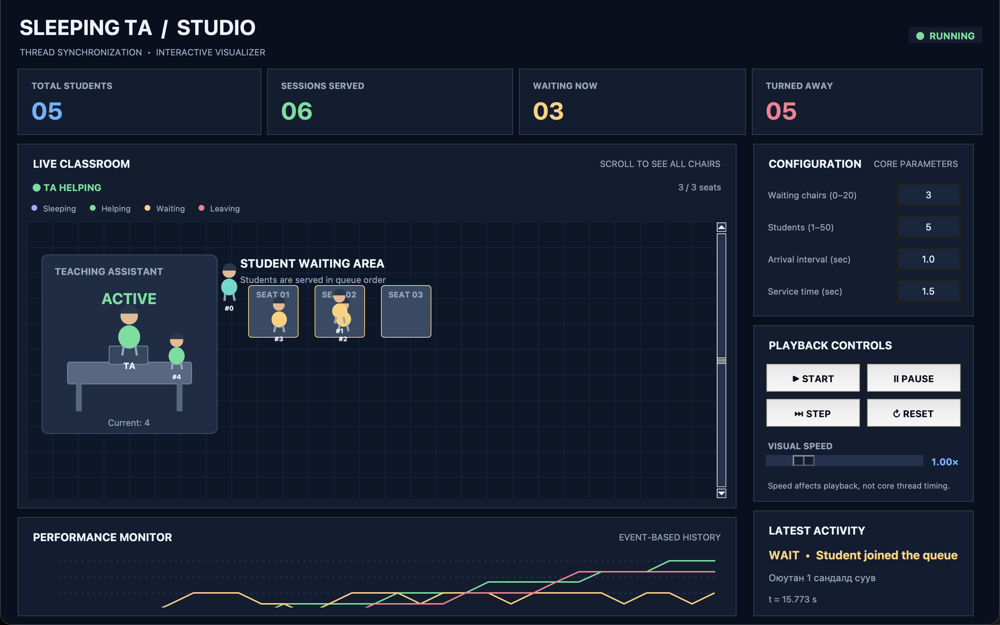

**S7_pause** (PAUSE / RESUME)

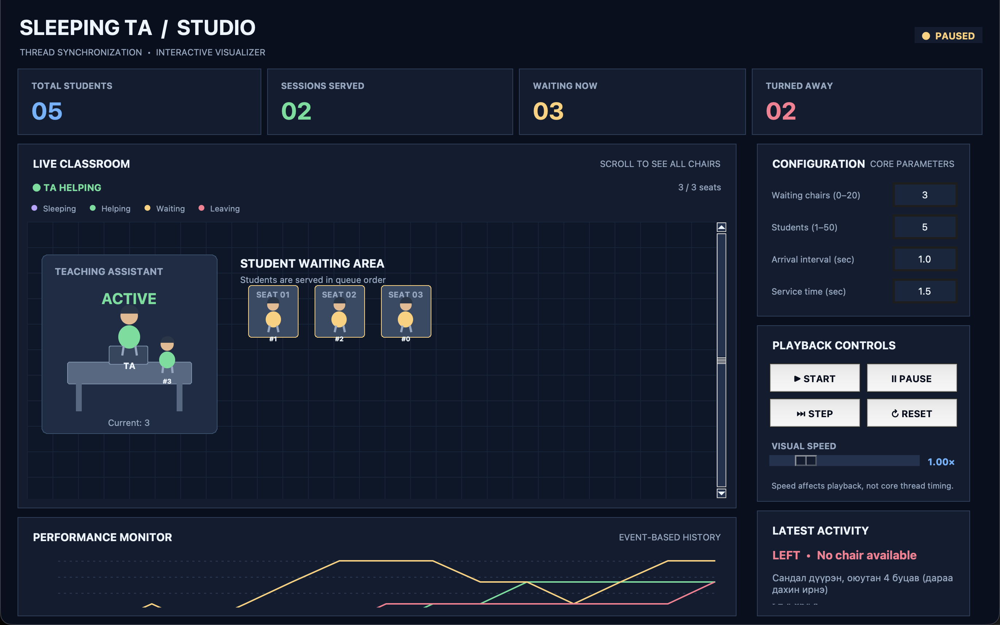

**S8** (STEP)

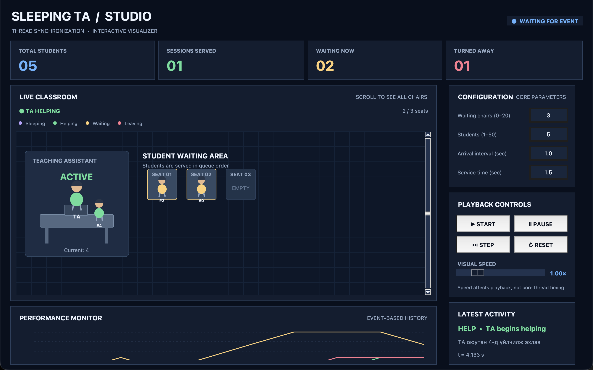

**S9** (RESET)


**S9_before_reset** (RESET)

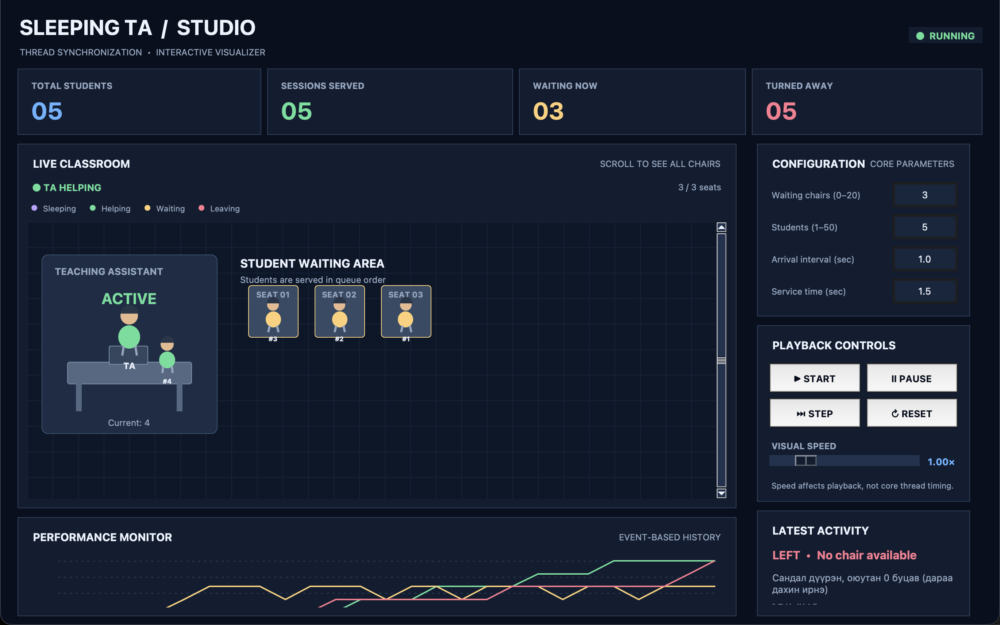

**S10** (Буруу оролт: хязгаараас хэтэрсэн)


**S11** (Буруу оролт: текст)

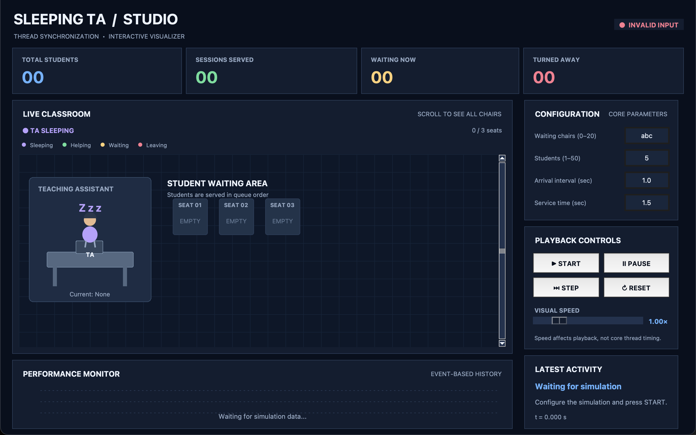

## 6. Edge case тестүүд

Файл: `tests/test_edge_cases.py` (27 тест). Үр дүн: `Ran 27 tests in 22.8s: OK`.

| № | Бүлэг | Edge case | Оролт / нөхцөл | Хүлээгдэх үр дүн | Үр дүн |
|---|---|---|---|---|---|
| 1 | Тохиргооны хязгаар | Сандлын хязгаар | 0 ба 20 / 21 ба -1 | 0, 20 зөв. 21, -1 алдаа | Тэнцсэн |
| 2 | Тохиргооны хязгаар | Оюутны хязгаар | 1 ба 50 / 0 ба 51 | 1, 50 зөв. 0, 51 алдаа | Тэнцсэн |
| 3 | Тохиргооны хязгаар | Хугацааны хязгаар | 0.001 ба 60 / 0 ба 60.01 | 0.001, 60 зөв. 0, 60.01 алдаа | Тэнцсэн |
| 4 | Тохиргооны хязгаар | nan, inf, -inf | Хугацааны талбарт | ValueError | Тэнцсэн |
| 5 | Тохиргооны хязгаар | Хоосон зай, 1e1 | " 3 ", "1e1" | Зөв уншина (3, 10.0) | Тэнцсэн |
| 6 | Тохиргооны хязгаар | Бүхэл тоон талбарт бутархай, текст, хоосон | "3.0", "5.5", "", "три" | ValueError | Тэнцсэн |
| 7 | Тохиргооны хязгаар | Seed талбар | "", "-5" / "abc", "1.5" | None, -5 зөв. Бусад алдаа | Тэнцсэн |
| 8 | Тохиргооны хязгаар | Алдааны мессеж | "abc" | "Сандлын тоо" ба "abc" гэж бичсэн ойлгомжтой мессеж | Тэнцсэн |
| 9 | Тохиргооны хязгаар | Simulation-д шууд буруу Config | num_chairs=-1 | ValueError | Тэнцсэн |
| 10 | Эхлүүлэх, зогсоох, pause, reset | Эхлэхээс өмнө stop | stop() | Алдаа гарахгүй | Тэнцсэн |
| 11 | Эхлүүлэх, зогсоох, pause, reset | Хоёр удаа stop | stop(); stop() | Алдаа гарахгүй, thread 0 | Тэнцсэн |
| 12 | Эхлүүлэх, зогсоох, pause, reset | Эхлэхээс өмнө pause | pause(); start() | Resume хүртэл зөвхөн SIM_START гарна | Тэнцсэн |
| 13 | Эхлүүлэх, зогсоох, pause, reset | Pause үед reset | pause(); reset() | Pause арилна, event цэвэр | Тэнцсэн |
| 14 | Эхлүүлэх, зогсоох, pause, reset | Буруу тохиргоотой reset | reset(Config(99)) | ValueError, симуляци зогссон. Дараа нь хэвийн reset болно | Тэнцсэн |
| 15 | Эхлүүлэх, зогсоох, pause, reset | 6 удаа дараалан reset | start → reset ×6 | Thread гоожихгүй | Тэнцсэн |
| 16 | Эхлүүлэх, зогсоох, pause, reset | Event-ийн төгсгөл | stop | SIM_STOP яг нэг удаа, хамгийн сүүлд | Тэнцсэн |
| 17 | Synchronization-ы зөв байдал | FIFO дараалал | 5 сандал, 8 оюутан | Эхэлж суусан нь эхэлж үйлчлүүлнэ | Тэнцсэн |
| 18 | Synchronization-ы зөв байдал | Ирэлт бүр хаана очсон | 2 сандал, 10 оюутан | Бүгд суусан эсвэл буцсан. LEAVES тоо = turned_away | Тэнцсэн |
| 19 | Synchronization-ы зөв байдал | Үйлчлүүлсэн ≤ суусан | 3 сандал, 6 оюутан | served суусан тооноос хэтрэхгүй | Тэнцсэн |
| 20 | Synchronization-ы зөв байдал | Цаг хугацаа | 3 сандал, 10 оюутан | Event-ийн t буурахгүй | Тэнцсэн |
| 21 | Synchronization-ы зөв байдал | current талбар | 3 сандал, 5 оюутан | TA_START-д current = оюутан, TA_DONE-д None | Тэнцсэн |
| 22 | Synchronization-ы зөв байдал | Эхний оюутан TA-г сэрээнэ | 1 оюутан | SIM_START → WAKES_TA → WAITS → TA_START | Тэнцсэн |
| 23 | Synchronization-ы зөв байдал | Дараалал хоосорвол TA унтана | 1 оюутан, удаан ирнэ | TA_DONE-ий дараа TA_SLEEP гарна | Тэнцсэн |
| 24 | Synchronization-ы зөв байдал | 1 сандал, 1 оюутан | 1 / 1 | 3-аас олон үйлчлүүлнэ, хэзээ ч буцахгүй | Тэнцсэн |
| 25 | Synchronization-ы зөв байдал | Сандал хангалттай | 20 сандал, 10 оюутан | Хэн ч буцахгүй | Тэнцсэн |
| 26 | Synchronization-ы зөв байдал | Дээд ачаалал | 20 сандал, 50 оюутан | Дараалал 20-оос хэтрэхгүй, давхцахгүй, thread 0, deadlock-гүй | Тэнцсэн |
| 27 | Synchronization-ы зөв байдал | 0 сандал | 0 сандал, 5 оюутан | TA унтсан хэвээр, хэн ч үйлчлүүлэхгүй | Тэнцсэн |

## 7. Илэрсэн ажиглалтууд

1. **UI-ийн дүрслэл ачаалал ихтэй үед хоцорно.** Олон оюутан буцдаг тохиргоонд (S2, S6) UI нь event-үүдийг тогтмол хурдаар тоглуулдаг тул дэлгэц дээрх "үйлчлүүлсэн" тоо core-ийн бодит тооноос бага харагдана. Core-ийн ажиллагаа зөв. Санал: хоцрол ихтэй үед event-үүдийг нэгтгэх эсвэл хурдыг автоматаар нэмэх.
2. **Буруу тохиргоотой reset(new_config) симуляцийг зогсоосон хэвээр үлдээнэ.** reset нь эхлээд stop() хийж, дараа нь тохиргоог шалгадаг тул шалгалт алдаатай бол симуляци зогссон, start() дахин дуудахад "аль хэдийн эхэлсэн" гэсэн алдаа гарна. UI тохиргоог урьдчилан шалгадаг тул хэрэглэгчид энэ нь тохиолддоггүй. Санал: reset-д эхлээд тохиргоог шалгаад дараа нь stop() хийх.
3. **STEP товч буфер хоосон үед хэд хэдэн event нэг дор үзүүлж болно.** Буфер хоосон үед STEP нь "WAITING FOR EVENT" гэж харуулаад core-г үргэлжлүүлдэг. Дараагийн STEP-д нэгээс олон event орж ирсэн тохиолдол ажиглагдсан.
4. **UI-д seed оруулах талбар байхгүй.** Core нь seed дэмждэг ч UI-д талбар байхгүй тул нэг сценарийг яг ижил тоогоор дахин гаргах боломжгүй. Тиймээс хүлээгдэх үр дүнг чанарын хэлбэрээр бичсэн.

## 8. Дүгнэлт

- Багийн 11 тест: **11/11 тэнцсэн** (14.97 сек).
- Edge case тест: **27/27 тэнцсэн** (22.8 сек).
- UI сценари: **11 сценарийн 11 тэнцсэн**.
- Synchronization-ы гол шинж (mutex-ээр хамгаалсан дараалал, semaphore-оор унтах/сэрэх, FIFO, сандлын тоо хэтрэхгүй байх, deadlock-гүй байх) бүх тохиргоонд зөв ажилласан.
- Илэрсэн гол сул тал нь UI-ийн дүрслэл ачаалал ихтэй үед core-оос хоцрох явдал (7-р хэсэг).

## 9. Дахин ажиллуулах заавар

Төслийн үндсэн хавтсанд (Python 3.14 болон Tk 9 шаардлагатай, macOS-ийн суурь Python 3.9-д UI зөв зурагдахгүй):

```bash
python3 -m unittest src.test_ta_core            # багийн 11 тест
python3 -m unittest discover -s tests -v        # 27 edge case тест
python3 tests/core_scenarios.py                 # core дээрх бодит тоо (~2 мин)
python3 tests/ui_scenarios.py all               # UI сценари + screenshot (~3.5 мин, цонх нээгдэнэ)
```
